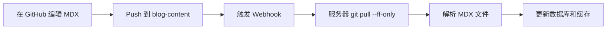
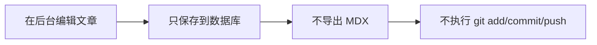
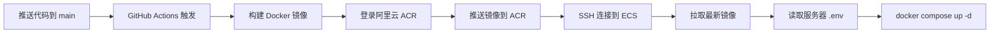

# 🚀 部署指南 - 环境变量配置

本文档说明如何在生产环境中正确配置环境变量。

---

## 📋 环境变量管理策略

### 1. 文件位置总览

```
项目结构：
├── .env.example                    # 开发环境模板（已提交到 Git）
├── .env.production.template        # 生产环境模板（已提交到 Git）
├── .env                           # ❌ 本地/服务器实际配置（不提交到 Git）
└── .github/workflows/
    └── deploy.yml                 # GitHub Actions 部署脚本
```

### 2. 环境变量配置位置

根据你的部署架构，环境变量需要配置在**两个地方**：

#### 📍 位置 1: 服务器上的 `.env` 文件（主要配置）

**路径**: `/home/tomy/blog_fr/.env`

**用途**:

- Docker Compose 在服务器上运行时读取
- 包含所有敏感信息（数据库密码、密钥等）
- 配置域名、数据库、后端、前端等所有服务

**创建步骤**:

```bash
# 1. SSH 登录到你的阿里云 ECS
ssh tomy@your-server-ip

# 2. 进入部署目录
cd /home/tomy/blog_fr

# 3. 创建 .env 文件（基于模板）
cp .env.production.template .env

# 4. 编辑配置文件
vim .env  # 或使用 nano .env
```

**必须修改的字段**:

```bash
# 域名配置
DOMAIN_NAME=www.yourdomain.com              # 前端域名
API_DOMAIN_NAME=api.yourdomain.com          # 后端 API 域名

# 数据库密码
POSTGRES_PASSWORD=your_strong_db_password

# 后端密钥（生成方法：openssl rand -hex 32）
SECRET_KEY=your_generated_secret_key
DATABASE_URL=postgresql://postgres:your_strong_db_password@db:5432/blog_fr

# 管理员密码
FIRST_SUPERUSER_PASSWORD=your_admin_password

# CORS 配置（使用你的真实域名）
BACKEND_CORS_ORIGINS=["https://www.yourdomain.com","https://api.yourdomain.com"]

# 前端配置
NEXT_PUBLIC_API_URL=https://api.yourdomain.com
FRONTEND_URL=https://www.yourdomain.com

# 认证密钥
AUTH_GATE_SECRET=your_auth_gate_secret
REVALIDATE_SECRET=your_revalidate_secret

# 媒体文件 URL
MEDIA_URL=https://api.yourdomain.com/media/
BASE_URL=https://api.yourdomain.com

# Git Webhook 密钥（用于 GitHub → 服务器同步）
WEBHOOK_SECRET=your_webhook_secret_key
```

#### 📍 位置 2: GitHub Secrets（CI/CD 配置）

**路径**: GitHub 仓库 → Settings → Secrets and variables → Actions

**用途**:

- GitHub Actions 部署时使用
- 主要用于构建时需要的变量和服务器连接信息

**需要配置的 Secrets**:

| Secret 名称           | 说明                        | 示例值                     |
| --------------------- | --------------------------- | -------------------------- |
| `ACR_USERNAME`        | 阿里云 ACR 用户名（推荐）   | nick1167443868             |
| `ACR_PASSWORD`        | 阿里云 ACR 固定密码（推荐） | your_acr_password          |
| `ECS_IP`              | 服务器 IP 地址              | 123.456.789.0              |
| `ECS_USER`            | SSH 用户名                  | tomy                       |
| `ECS_PASSWORD`        | SSH 密码                    | your_ssh_password          |
| `NEXT_PUBLIC_API_URL` | 前端构建时的 API 地址       | https://api.yourdomain.com |

**可选的 Secrets（AccessKey 方式，不推荐）**:

| Secret 名称        | 说明                    | 示例值    |
| ------------------ | ----------------------- | --------- |
| `ALIYUN_AK_ID`     | 阿里云 AccessKey ID     | LTAI5t... |
| `ALIYUN_AK_SECRET` | 阿里云 AccessKey Secret | xxxxxx    |

> **💡 推荐使用固定密码方式**：固定密码比 AccessKey 更简单、更稳定，适合容器镜像推送场景。

**配置步骤**:

1. **设置 ACR 固定密码**:

   - 登录阿里云容器镜像服务控制台
   - 进入"访问凭证"页面
   - 点击"设置固定密码"
   - 记下你的用户名（通常显示在页面顶部，如 `nick1167443868`）

2. **添加 GitHub Secrets**:
   - 访问: `https://github.com/你的用户名/blog_fr/settings/secrets/actions`
   - 点击 "New repository secret"
   - 逐个添加上述 Secrets

---

## 🔄 Git → 数据库单向同步配置

当前系统只支持 **Git → 数据库** 单向导入：

- **GitHub → 服务器**：通过 Webhook 自动同步文章内容。
- **服务器 → GitHub**：已停用。后台编辑只修改数据库，`POST /ops/git/push` 固定返回 `409 GITOPS_READ_ONLY`。

权威说明见 [backend/docs/ONE_WAY_SYNC.md](./backend/docs/ONE_WAY_SYNC.md)。

### 1. 配置只读拉取凭据

服务器只需要读取 `blog-content` 的权限，不需要 push 权限：

```bash
# 建议使用 GitHub Deploy Key，只勾选读权限
ssh-keygen -t ed25519 -C "blog-content-readonly"
cat ~/.ssh/id_ed25519.pub
# 在 blog-content 仓库 Settings → Deploy keys 添加，不要勾选 Allow write access

ssh -T git@github.com
```

如果使用 HTTPS，请使用只读的 fine-grained token，并只授予 Contents: Read。

### 2. 初始化 content 目录

`content` 不是 Git submodule；它是独立的 `blog-content` 仓库克隆，位于网站仓库下的 `./content` 并被 `.gitignore` 忽略。

```bash
cd /home/tomy/blog_fr

# 目录不存在或为空时，克隆内容仓库（使用只读地址）
git clone git@github.com:your-account/blog-content.git content
cd content
git remote -v
# 应为 blog-content 的只读地址
git rev-parse --abbrev-ref HEAD
# Deploy Key 只读即可，但工作区必须可写，因为 git pull 需要更新文件
```

三份 Compose 文件都使用 `./content:/git_root/content` 和
`CONTENT_DIR=/git_root/content`，因此宿主机 `./content` 必须包含上一步的
`blog-content` 工作区。后端本地直接运行时，`CONTENT_DIR` 以 `backend/`
为工作目录解析：可用 `../content`，或直接指向相邻内容仓库的绝对路径。

本地 `content` 目录和 `.git` 必须可写，因为 `git pull` 需要更新工作区，同步游标写在 `.git/.gitops_last_sync`。

### 3. 配置 GitHub Webhook

在 blog-content 仓库中配置 Webhook：

```
Payload URL: https://api.yourdomain.com/api/v1/ops/git/webhook
Content type: application/json
Secret: your_webhook_secret_key  # 与 .env 中的 WEBHOOK_SECRET 一致
Events: Just the push event
Active: ✓
```

`[skip ci]` 不会阻止内容导入；重复通知由同步锁和成功游标处理。

### 4. 工作流程

#### 在 GitHub 上编辑文章



#### 在管理后台编辑文章



Git 来源文章的后台修改可能被下一次同步覆盖；后台删除不会删除 Git 文件，全量同步可能重新导入。

### 5. 上线前清理

- 备份数据库和内容仓库工作区。
- 检查内容仓库是否有历史回写产生的未提交文件；先备份并确认来源，再决定提交或清理，不要直接 `git reset --hard`。
- 关闭旧的小时级推送任务，确认 `ENABLE_GIT_AUTO_PUSH` 不再使用。
- 撤销部署环境对 GitHub 远程仓库的写权限，只保留拉取权限。
- 部署后手动执行一次全量同步，并检查 `git status` 和 `git log`，确认没有网站生成的提交。

### 6. 详细文档

- [Git → 数据库单向同步](./backend/docs/ONE_WAY_SYNC.md) - 当前权威说明
- [Frontmatter 字段规范](./GIT_SYNC_GUIDE.md) - 内容字段说明

### 7. 故障排查

#### 问题 1: Webhook 返回 404

**检查**：

- URL 是否正确：`https://api.yourdomain.com/api/v1/ops/git/webhook`
- 后端服务是否正常运行
- Caddy 反向代理配置是否正确

#### 问题 2: 增量同步失败

**检查**：

```bash
# 1. 检查只读拉取凭据
docker exec -it blog_fr-backend-1 ssh -T git@github.com

# 2. 查看内容仓库和游标
docker exec -it blog_fr-backend-1 bash
cd /app/content
git status --porcelain
ls -l .git/.gitops_last_sync .git/.gitops_needs_full_sync
```

同步失败时游标不会推进；下一次同步会先做全量对账。历史未提交文件先备份确认，不要直接丢弃。

#### 问题 3: Webhook Secret 验证失败

**检查**：

- `.env` 中的 `WEBHOOK_SECRET` 是否与 GitHub Webhook 配置一致
- 重启后端服务：`docker compose restart backend`

---

## 🔄 部署流程说明

### 当前部署流程



### 关键点

1. **ACR 认证**:

   - 推荐使用**固定密码**方式（`ACR_USERNAME` + `ACR_PASSWORD`）
   - 也可以使用 AccessKey 方式（`ALIYUN_AK_ID` + `ALIYUN_AK_SECRET`）
   - 固定密码更稳定，适合 CI/CD 场景

2. **构建阶段**:

   - Frontend 镜像构建时需要 `NEXT_PUBLIC_API_URL`（从 GitHub Secrets 读取）
   - Backend 镜像不需要构建时变量

3. **运行阶段**:
   - 所有运行时环境变量从服务器的 `.env` 文件读取
   - Docker Compose 自动加载 `.env` 文件

---

## ⚠️ 安全注意事项

### ✅ 应该做的

- ✅ 将 `.env` 添加到 `.gitignore`（已完成）
- ✅ 使用强密码和随机密钥
- ✅ 定期轮换密钥和密码
- ✅ 限制服务器 SSH 访问（使用密钥认证）
- ✅ 使用 GitHub Secrets 存储敏感信息

### ❌ 不应该做的

- ❌ 不要将 `.env` 文件提交到 Git
- ❌ 不要在代码中硬编码密钥
- ❌ 不要在公开的 Issue 或 PR 中暴露密钥
- ❌ 不要使用弱密码（如 `123456`、`password`）

---

## 🛠️ 常用命令

### 在服务器上查看环境变量

```bash
# 查看 .env 文件内容（注意保护敏感信息）
cat /home/tomy/blog_fr/.env

# 查看容器使用的环境变量
docker compose config

# 查看特定服务的环境变量
docker compose exec backend env
```

### 更新环境变量后重启服务

```bash
cd /home/tomy/blog_fr

# 重启所有服务
docker compose down
docker compose up -d

# 或只重启特定服务
docker compose restart backend
docker compose restart frontend
```

### 生成安全密钥

```bash
# 生成 SECRET_KEY
openssl rand -hex 32

# 生成随机密码
openssl rand -base64 24
```

---

## 🔍 故障排查

### 问题 1: GitHub Actions 部署失败 - ACR 认证错误

**错误信息**: `unauthorized: authentication required`

**原因**: 阿里云容器镜像服务认证失败

**解决方案**:

1. **检查 GitHub Secrets 是否正确配置**:

   - `ACR_USERNAME`: 你的 ACR 用户名（如 `nick1167443868`）
   - `ACR_PASSWORD`: 在 ACR 控制台设置的固定密码

2. **验证 ACR 固定密码**:

   ```bash
   # 在本地测试登录
   echo "your_password" | docker login \
     crpi-qvig00qix6yo4bi5.cn-hangzhou.personal.cr.aliyuncs.com \
     --username your_username \
     --password-stdin
   ```

3. **确认仓库已创建**:
   - 登录阿里云 ACR 控制台
   - 确认以下仓库存在：
     - `blog-project/blog-backend`
     - `blog-project/blog-frontend`
     - `blog-project/blog-caddy`

### 问题 2: 服务启动失败

**检查步骤**:

```bash
# 1. 查看服务日志
docker compose logs backend
docker compose logs frontend

# 2. 检查 .env 文件是否存在
ls -la /home/tomy/blog_fr/.env

# 3. 验证环境变量是否正确加载
docker compose config | grep -A 5 "environment"
```

### 问题 3: CORS 错误

**原因**: `BACKEND_CORS_ORIGINS` 配置不正确

**解决**:

```bash
# 编辑 .env 文件
vim /home/tomy/blog_fr/.env

# 确保使用 JSON 数组格式
BACKEND_CORS_ORIGINS=["https://www.yourdomain.com","https://api.yourdomain.com"]

# 重启后端服务
docker compose restart backend
```

### 问题 4: 前端无法连接后端

**检查清单**:

- [ ] `NEXT_PUBLIC_API_URL` 是否正确（应该是 `https://api.yourdomain.com`）
- [ ] `BACKEND_INTERNAL_URL` 是否正确（应该是 `http://backend:8000`）
- [ ] Caddy 是否正确配置了反向代理
- [ ] 防火墙是否开放了 80 和 443 端口

### 问题 5: Git 拉取或同步失败

**错误信息**: `Git pull failed`、`Not a git repository` 或同步游标错误。

**解决步骤**:

```bash
# 1. 检查只读拉取凭据
docker exec -it blog_fr-backend-1 ssh -T git@github.com

# 2. 检查 content 目录是否为 Git 仓库
docker exec -it blog_fr-backend-1 bash
cd /app/content
git remote -v
git status --porcelain

# 3. 检查本地 .git 是否可写（游标写入 .git/.gitops_last_sync）
ls -ld /app/content/.git

# 4. 查看后端日志
docker compose logs backend | grep -i git
```

如果工作区有历史回写产生的未提交文件，先备份并确认来源，再决定提交或清理；不要直接 `git reset --hard`。网站不会再产生新的 Git 提交。

### 问题 6: Webhook 同步失败

**检查步骤**:

```bash
# 1. 查看后端日志
docker compose logs backend | grep -i webhook

# 2. 验证 Webhook Secret
# 在 GitHub Webhook 设置中点击 "Recent Deliveries"
# 查看响应状态和错误信息

# 3. 手动触发同步
docker exec -it blog_fr-backend-1 python scripts/sync_git_content.py

# 4. 检查 content 目录权限
docker exec -it blog_fr-backend-1 ls -la /app/content
```

---

## 📚 相关文档

- [README.md](./README.md) - 项目介绍和快速开始
- [.env.production.template](./.env.production.template) - 生产环境配置模板
- [docker-compose.yml](./docker-compose.yml) - Docker Compose 配置
- [GitHub Actions 部署配置](./.github/workflows/deploy.yml)
- [Git → 数据库单向同步](./backend/docs/ONE_WAY_SYNC.md) - 当前同步流程和上线检查
- [Frontmatter 字段规范](./GIT_SYNC_GUIDE.md) - 内容字段说明

---

## 🆘 需要帮助？

如果遇到问题，请检查：

1. 服务器上的 `.env` 文件是否存在且配置正确
2. GitHub Secrets 是否都已配置
3. 域名 DNS 是否正确解析到服务器 IP
4. 服务器防火墙是否开放必要端口（80, 443）
5. Docker 容器日志中的错误信息
6. SSH/HTTPS 只读拉取凭据是否正确配置
7. GitHub Webhook 是否正确配置（用于 Git → 数据库导入）

---

**祝部署顺利！** 🎉
