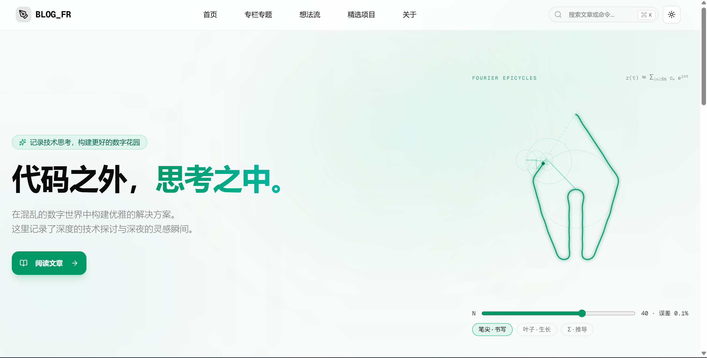
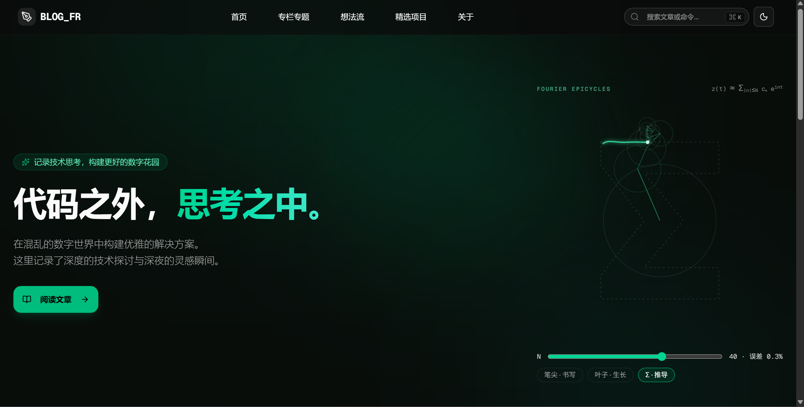

# 🚀 Blog FR - 现代全栈博客系统

[](https://github.com/sumanin5/blog_fr)
[](LICENSE)
[](https://www.python.org/)
[](https://nodejs.org/)
[](https://pnpm.io/)
[](https://github.com/astral-sh/uv)

**Blog FR** 是一个基于 **FastAPI** 和 **Next.js 16** 构建的现代全栈博客系统。它集成了高性能后端、React Server Components 以及丰富的 MDX 渲染能力，旨在提供极致的写作与阅读体验。

## 🌓 主题展示

支持深色和浅色两种主题模式，为用户提供舒适的阅读体验：

<table>
  <tr>
    <td width="50%" align="center">
      <b>☀️ 浅色主题</b><br/>
      
    </td>
    <td width="50%" align="center">
      <b>🌙 深色主题</b><br/>
      
    </td>
  </tr>
</table>

> 💡 主题状态由 `next-themes` 管理，支持跟随系统与偏好保存；切换时使用 View Transitions API 做页面级水波纹过渡，不支持该 API 或开启“减少动态效果”时直接切换。首页右侧为可交互的傅里叶本轮（Fourier Epicycles）手稿。[查看更多功能展示 →](./SHOWCASE.md)

---

## ✨ 核心特性

- 🎨 **现代设计**: Tailwind CSS 4 + shadcn/ui，深色/浅色主题无缝切换，响应式布局
- 📝 **增强型 MDX**: Mermaid 图表、代码高亮 (@tanstack/highlight)、数学公式 (KaTeX)、交互式组件
- ⚡ **混合渲染架构**:
  - **ISR**: 公开页面静态生成 + 定时重验证（首页 60s、文章页 300s），内容同步后通过 revalidate webhook 主动刷新
  - **CSR**: 管理后台，流畅的 SPA 体验
  - **后端**: FastAPI + SQLModel，异步高性能
- 🗂️ **内容组织**: 文章 (articles) 与想法 (ideas) 两种内容类型，各自下设专栏；专栏页提供地形图式导航
- 🔗 **OpenAPI 驱动**: hey-api 自动生成类型安全的前端 SDK
- 🖼️ **媒体管理**: 多规格缩略图自动生成，SVG 图标支持
- 🔍 **SEO 与可发现性**: 动态元数据、OpenGraph、sitemap、robots、RSS；为 AI 爬虫提供 `llms.txt` / `llms-full.txt` 与每篇文章的纯 Markdown 版本
- 📊 **访问分析**: 浏览量与 PV 统计、Core Web Vitals 真实用户监控、基于 ip2region 的离线 IP 归属地查询
- 🔭 **可观测性**: OpenTelemetry 打通 Next.js → FastAPI → SQL 全链路追踪，可选接入 Jaeger
- 🐳 **容器化部署**: Docker Compose + Caddy（自动 HTTPS），CI 检查通过后按 commit SHA 构建镜像并发布
- 🧪 **质量保证**: Pytest + 覆盖率、Vitest、类型检查与 Lint，均在 CI 中作为发布门禁
- 🔄 **GitOps 同步**: 依赖注入容器模式，支持增量/全量同步，后台提交与同步共用仓库锁
- 🛡️ **统一错误处理**: 标准化错误响应格式，所有错误响应携带 `request_id`

> 📸 **查看效果**: 想要直观了解这些特性？访问 [功能展示文档](./SHOWCASE.md) 查看完整的界面截图和功能演示！

---

## 🛠️ 技术栈

### 后端 (Backend)

- **框架**: [FastAPI](https://fastapi.tiangolo.com/) (Python 3.13+)
- **ORM**: [SQLModel](https://sqlmodel.tiangolo.com/) (SQLAlchemy + Pydantic)
- **迁移**: [Alembic](https://alembic.sqlalchemy.org/)
- **数据库**: [PostgreSQL 17](https://www.postgresql.org/)
- **包管理**: [UV](https://github.com/astral-sh/uv) (极速 Python 包管理器)
- **API 文档**: [Scalar](https://scalar.com/) + OpenAPI 3.0

### 前端 (Frontend)

- **框架**: [Next.js 16](https://nextjs.org/) (React 19 + App Router)
- **语言**: [TypeScript](https://www.typescriptlang.org/)
- **样式**: [Tailwind CSS 4](https://tailwindcss.com/), [Shadcn UI](https://ui.shadcn.com/)
- **状态管理**: [TanStack Query v5](https://tanstack.com/query)
- **数据获取**: [hey-api SDK](https://www.heypi.com/) (基于 OpenAPI 自动生成)
- **主题系统**: [next-themes](https://github.com/pacocoursey/next-themes) + View Transitions API
- **内容渲染**: MDX + Mermaid + KaTeX + @tanstack/highlight

### 基础设施 (Infrastructure)

- **反向代理**: [Caddy](https://caddyserver.com/)（自动申请 HTTPS 证书）
- **可观测性**: [OpenTelemetry](https://opentelemetry.io/) + [Jaeger](https://www.jaegertracing.io/)
- **CI/CD**: GitHub Actions + Docker Buildx（GHA 缓存）+ 阿里云 ACR 镜像仓库

---

## 🚀 快速开始

### 1. 克隆项目

```bash
git clone https://github.com/sumanin5/blog_fr.git
cd blog_fr
```

### 2. 环境配置

复制环境变量模板并根据需要修改：

```bash
cp .env.example .env
cp frontend/.env.example frontend/.env
```

### 3. 一键启动 (Docker)

这是最快的方式，将同时启动数据库、后端、前端和管理工具：

```bash
# 开发环境（支持热重载）
docker compose -f docker-compose.dev.yml up

```

访问：

- 前端: `http://localhost:3000`
- API 文档: `http://localhost:8000/scalar`
- 后端健康检查: `http://localhost:8000/`

> 生产环境的 `docker-compose.yml` 引用 CI 构建好的镜像，必须指定 `IMAGE_TAG`，不适合直接在本地启动。本地模拟生产请使用 `./scripts/test-prod-local.sh`（读取 `.env.prod.local` 与 `docker-compose.prod.local.yml`）。

---

## 💻 本地开发

### 前端开发

```bash
cd frontend
pnpm install
pnpm dev        # 启动开发服务器 (http://localhost:3000)
pnpm build      # 构建生产版本
pnpm test       # 运行测试
pnpm type-check # 类型检查
pnpm lint       # 代码检查
```

### 后端开发

```bash
cd backend
uv sync            # 安装依赖
uv run fastapi dev app/main.py  # 启动开发服务器 (http://localhost:8000)
uv run pytest      # 运行测试
```

### 🔧 自动化开发脚本

项目在 `scripts/` 目录下提供了一系列脚本来简化日常开发任务：

| 脚本                          | 描述                   | 使用场景                                         |
| ----------------------------- | ---------------------- | ------------------------------------------------ |
| `./scripts/generate-api.sh`   | **全自动生成 API SDK** | 后端接口变更后，一键更新前端 TypeScript 类型定义 |
| `./scripts/db-migrate.sh`     | 数据库迁移辅助         | 创建新表或修改模型后使用                         |
| `./scripts/docker-rebuild.sh` | 重建所有 Docker 容器   | 修改了依赖或 Dockerfile 后使用                   |
| `./scripts/docker-rebuild-frontend.sh` | 仅重建前端容器 | 前端 `package.json` 变更后使用 |
| `./scripts/sync-posts.sh`     | 同步 `content/` 文章   | 本地将 Git 内容目录同步到数据库                  |
| `./scripts/test-prod-local.sh` | 本地模拟生产部署      | 发布前在本机验证生产配置                         |
| `./scripts/deploy-release.sh` | 服务器端发布脚本       | 由 CI 调用：拉取镜像 → 迁移 → 启动 → 健康检查   |

### API SDK 生成

项目使用 OpenAPI 规范实现前后端类型安全：

1. 后端自动生成 OpenAPI schema: `http://localhost:8000/openapi.json`
2. 前端使用 hey-api/openapi-ts 自动生成 TypeScript SDK
3. 修改后端 API 后在根目录运行 `./scripts/generate-api.sh`（或在 `frontend/` 下执行 `pnpm api:generate`）更新前端类型

---

## 🗂️ 项目结构

```text
blog_fr/
├── backend/                      # FastAPI 后端服务
│   ├── app/
│   │   ├── core/                # 核心配置和工具
│   │   ├── users/               # 用户认证和授权
│   │   ├── posts/               # 文章、专栏、标签
│   │   ├── media/               # 媒体文件管理
│   │   ├── git_ops/             # GitOps 内容同步
│   │   ├── analytics/           # 访问分析与 Web Vitals
│   │   └── middleware/          # 自定义中间件
│   ├── tests/                   # Pytest 测试
│   ├── alembic/                 # 数据库迁移
│   └── pyproject.toml           # Python 项目配置
├── frontend/                     # Next.js 前端应用
│   ├── src/
│   │   ├── app/                 # Next.js App Router 页面
│   │   ├── components/          # React 组件
│   │   ├── shared/api/          # 自动生成的 API SDK
│   │   └── config/              # 配置文件
│   ├── public/                  # 静态资源
│   └── package.json             # Node.js 项目配置
├── content/                     # Git 管理的文章内容（articles/、ideas/）
├── caddy/                       # Caddy 反向代理镜像与配置
├── scripts/                     # 自动化脚本
├── .github/workflows/           # CI 与发布流水线
├── docker-compose.yml           # 生产环境配置
├── docker-compose.dev.yml       # 开发环境配置
├── docker-compose.observability.yml  # 可选：Jaeger 链路追踪
├── ARCHITECTURE.md              # 架构详细文档
└── README.md                    # 本文件
```

### 架构亮点

- **混合渲染**: Next.js App Router 支持 SSR 和 CSR，根据页面特性自动选择最佳渲染策略
- **类型安全**: OpenAPI schema 自动生成 TypeScript SDK，确保前后端接口类型一致
- **模块化设计**: 后端按功能模块划分（users、posts、media、git_ops、analytics），前端按组件和功能组织
- **开发体验**: 支持 Hot Reload、TypeScript 检查、自动格式化

### GitOps 内容同步模块

`git_ops` 模块是一个基于**依赖注入容器模式**的内容同步引擎，实现了从 Git 仓库到数据库的自动化内容管理。

**核心特性**:

- 🔄 **增量同步**: 基于 Git Diff 的智能增量同步，显著提升性能
- 📦 **依赖注入容器**: 统一管理所有依赖关系，支持延迟加载和单例模式
- 🛡️ **显式错误处理**: 采用 Pythonic 的 try-except 块，控制流清晰
- 🔍 **全链路追踪**: 所有操作都有详细的日志和错误追踪
- 🧪 **易于测试**: 可以轻松 mock 整个容器或单个组件

**架构模式**:

```
GitOpsService (门面)
    ↓
GitOpsContainer (容器)
    ↓
服务层 (SyncService, PreviewService, etc.)
    ↓
核心组件 (Scanner, Serializer, GitClient)
```

详细文档:

- [GitOps 架构设计](./backend/app/git_ops/ARCHITECTURE.md)
- [依赖注入详解](./backend/app/git_ops/DEPENDENCY_INJECTION_EXPLAINED.md)
- [同步流程可视化](./backend/app/git_ops/SYNC_FLOW_WITH_DI.md)

### 错误处理模式

项目采用了 **FastAPI 全局异常处理器模式**，这是一个标准且优秀的企业级实践：

**核心特点**:

- ✅ **统一响应结构**: 所有错误都遵循统一的 JSON 格式
- ✅ **集中式处理**: 业务代码只需 `raise` 异常，不需要关心如何返回 JSON
- ✅ **环境隔离**: 开发环境返回详细错误，生产环境隐藏敏感信息
- ✅ **全链路追踪**: 所有错误响应都包含 `request_id`

详见 [后端 README - 错误处理模式](./backend/README.md#-错误处理模式)。

关于架构的详细说明，请参阅 [架构文档](./ARCHITECTURE.md)。

---

## 🧪 测试

### 后端测试

```bash
cd backend
# 运行所有测试
uv run pytest

# 运行测试并生成覆盖率报告
uv run pytest --cov=app --cov-report=html

# 运行特定模块的测试
uv run pytest tests/api/posts/
uv run pytest tests/api/users/
uv run pytest tests/api/media/
```

### 前端测试

```bash
cd frontend
pnpm test
pnpm type-check
pnpm lint
```

### 数据库迁移

```bash
cd backend
# 创建新的迁移
uv run alembic revision --autogenerate -m "描述"

# 应用迁移
uv run alembic upgrade head

# 回滚迁移
uv run alembic downgrade -1
```

---

## 🚀 部署

### 发布流程

推送到 `main` 后由 [`deploy.yml`](./.github/workflows/deploy.yml) 自动完成，同一时间只运行一个发布：

1. **检查门禁**: 并行运行后端 CI（pytest + 覆盖率）与前端 CI（type-check、lint、测试、构建），全部通过才继续
2. **构建镜像**: 使用 Buildx + GitHub Actions 缓存构建 backend / frontend / caddy 镜像，以 commit SHA 为标签推送到阿里云 ACR
3. **服务器发布**: 上传本次的 `docker-compose.yml` 与 `scripts/deploy-release.sh`，由脚本依次执行：
   - 只拉取本次发布的应用镜像
   - 用新镜像执行 `alembic upgrade head`
   - 启动全部服务并等待健康检查通过
   - 保留上一个版本号，便于手动回滚

### 可选：链路追踪

```bash
docker compose -f docker-compose.yml -f docker-compose.observability.yml up -d
```

Jaeger UI 仅绑定在服务器本机 `127.0.0.1:16686`，需通过 SSH 隧道访问。

### 环境变量配置

**重要**: 生产环境部署需要正确配置环境变量。详细说明请查看 [部署指南](./DEPLOYMENT_GUIDE.md)。

**快速配置**:

1. **服务器上**: 在 `/home/tomy/blog_fr/.env` 创建配置文件

   ```bash
   cp .env.production.template .env
   vim .env  # 修改所有 CHANGEME 字段
   ```

2. **GitHub Secrets**: 配置 CI/CD 所需的密钥
   - `ACR_USERNAME` / `ACR_PASSWORD` - 阿里云容器镜像服务 (ACR) 登录凭据
   - `ECS_IP` / `ECS_USER` / `ECS_PASSWORD` - 服务器连接信息
   - `NEXT_PUBLIC_API_URL` - 前端 API 地址（构建时注入）
   - `CODECOV_TOKEN` - 上传后端覆盖率报告

主要环境变量（参考 `.env.production.template`）：

- **域名**: `DOMAIN_NAME`, `API_DOMAIN_NAME`
- **数据库**: `POSTGRES_USER`, `POSTGRES_PASSWORD`, `POSTGRES_DB`
- **后端**: `SECRET_KEY`, `ENVIRONMENT`, `BASE_URL`, `MEDIA_URL`
- **前端**: `NEXT_PUBLIC_API_URL`, `BACKEND_INTERNAL_URL`, `FRONTEND_URL`

> 📖 完整的环境变量说明和部署流程，请参阅 [部署指南](./DEPLOYMENT_GUIDE.md)

### API 端点

后端提供的主要 API 接口：

- **用户认证**: `/api/v1/users/register`, `/api/v1/users/login`
- **文章管理**: `/api/v1/posts/{post_type}`, `/api/v1/posts/{post_type}/slug/{slug}`（`post_type` 为 `articles` 或 `ideas`）
- **专栏**: `/api/v1/posts/{post_type}/categories`
- **媒体文件**: `/api/v1/media/upload`, `/api/v1/media/`
- **内容同步**: `/api/v1/ops/git/*`
- **访问分析**: `/api/v1/analytics/*`
- **API 文档**: `/scalar` (交互式 API 文档)

前端额外提供的公开路由：`/rss.xml`、`/sitemap.xml`、`/llms.txt`、`/llms-full.txt`、`/posts/{postType}/{slug}/raw`（文章 Markdown 原文）、`/api/health`。

---

## 📚 相关文档

- [功能展示](./SHOWCASE.md) - 界面截图和功能演示 ⭐
- [部署指南](./DEPLOYMENT_GUIDE.md) - 生产环境部署和环境变量配置 🚀
- [架构设计文档](./ARCHITECTURE.md) - 混合渲染架构和数据流详解
- [后端 API 文档](./backend/README.md) - FastAPI 开发指南
- [前端开发指南](./frontend/SETUP.md) - Next.js 开发环境配置
- [API 集成指南](./docs/api/FRONTEND_API_INTEGRATION_GUIDE.md) - 前端如何使用后端 API
- [错误处理协作指南](./frontend/ERROR_HANDLING.md) - 前后端错误处理机制详解

---

## 🤝 贡献指南

欢迎贡献！请随时提交 Issue 或 Pull Request。

1. Fork 本仓库
2. 创建特性分支 (`git checkout -b feature/AmazingFeature`)
3. 提交更改 (`git commit -m 'Add some AmazingFeature'`)
4. 推送到分支 (`git push origin feature/AmazingFeature`)
5. 开启 Pull Request

---

## 📄 许可证

本项目采用 [MIT](./LICENSE) 许可证。

---

**Happy Coding!** 🍕
